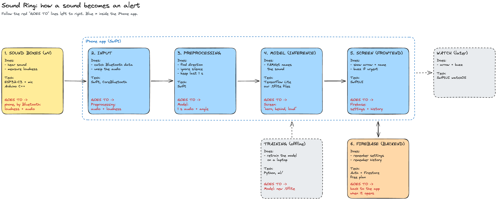

# Sound Ring

Fortnite's "visualize sound effects," in real life.

Four small sound boxes worn on the body hear the sounds around you. The iPhone app works out
where each sound came from and what it is, then shows it as an arrow around a bird's-eye view
of you. Built for people who are deaf or hard of hearing, and for anyone who wants sound
awareness (safety, privacy, babies). Texas Convergent IoT, Fall 2026.

**This README is the source of ground truth for the project.** If another doc in the repo
disagrees with it, this file wins and the other doc needs updating (see
[Docs that need reconciling](#docs-that-need-reconciling)).

| Read next | For |
|---|---|
| [`docs/architecture.md`](docs/architecture.md) | **Start here.** The layers, the tech stack and where data goes, with a diagram |
| [`docs/body-boxes-plan.md`](docs/body-boxes-plan.md) | How the boxes work out direction from loudness |
| [`docs/team-plan.md`](docs/team-plan.md) | Who builds what, week by week, and the contracts between lanes |
| [`docs/hardware-bom.md`](docs/hardware-bom.md) | Parts list for the 4 boxes |

## What we are building

**4 sound boxes**, worn on the chest (FRONT), upper back (BACK), left shoulder (LEFT) and right
shoulder (RIGHT). Each box has:

- **An ESP32-C3** (Seeed XIAO)
- **1 microphone** (INMP441)
- **A small battery** and a mini breadboard in a clip-on case

The boxes send to an **iPhone app (Swift)**, which does all the work:

- **Where** is the sound? Compare how loud each box hears it. Your body blocks sound, so the
  box facing the sound hears it loudest.
- **What** is the sound? YAMNet + our trained head, run on audio from the loudest box only.
- **Show it:** an arrow pointing at the sound, its name, how loud, and a buzz if it's urgent.

Example: a baby cries behind the wearer. The BACK box hears it loudest, the phone shows a
"baby cry" arrow pointing behind, and the phone buzzes.

**Phone first. The Apple Watch app comes later** as a second screen on the wrist; the phone
stays the brain.

## The rules

- **Audio never leaves the phone.** Input, preprocessing, inference and the screens all run
  inside the iPhone app. Alerts land in about 0.3 s and keep working with no signal.
- **Firebase is the only backend.** It stores settings and history. There is no server to
  write or host.
- **No training needed.** The model is already trained (`ml/models/`). Retrain later only if
  accuracy through the boxes' mics is bad, or to add sounds.
- **$0 for software and services.** Free Apple ID in Xcode (no paid Developer Program) and
  Firebase Spark only (never Blaze). That rules out push, Sign in with Apple, TestFlight, Cloud
  Storage and Cloud Functions; the workaround for each is in
  [`docs/team-plan.md`](docs/team-plan.md#free-tier-limits). Hardware (~$75 for 4 boxes) is the
  only cost.

## What the system works out from audio

| Attribute | Meaning | How | Where |
|---|---|---|---|
| **Direction** | where the sound is; 0° ahead, clockwise, 180° behind | Loudness above each box's quiet level, then `atan2(RIGHT − LEFT, FRONT − BACK)` ([details](docs/body-boxes-plan.md)) | iPhone |
| **Type** | what the sound is (siren, baby cry, knock, speech…) | YAMNet + our trained head (13 classes, `ml/`) on the loudest box's audio | iPhone |
| **Loudness** | how loud it is | Peak level from the loudest box | Box measures, iPhone shows |

## Sound filters

The app has filters so the wearer sees only the sound cues they care about. A filter is a set
of sound classes. Planned categories:

- **Safety**: sirens, car horns, alarms, glass breaking, and similar
- **Privacy**: speech and people nearby
- **Babies**: baby crying and related sounds
- More as user needs come in

Choosing which classes belong in each filter is a product decision driven by user needs, not a
technical one.

## Stack

| Part | Choice |
|---|---|
| Sound boxes (×4) | Seeed XIAO ESP32-C3, INMP441 I2S mic, LiPo; C++ (Arduino on PlatformIO), NimBLE |
| Link | Bluetooth LE, each box straight to the iPhone: loudness 10×/s from every box, IMA ADPCM audio from the loudest box only |
| iPhone app | Swift, SwiftUI, CoreBluetooth (background mode), Accelerate, TensorFlowLiteSwift, local notifications |
| Model | YAMNet + our trained head, `.tflite` files from `ml/models/`, bundled in the app |
| Backend | Firebase Spark (free): Anonymous Auth, Firestore |
| Watch (later) | SwiftUI on watchOS, WatchConnectivity, haptics |
| Distribution | Install from Xcode with a free Apple ID; re-install every 7 days |
| Retraining (optional) | Python, `ml/` |

## Open decisions

Owners and deadlines are in `docs/team-plan.md`.

1. Hardware money: Convergent budget or borrowed parts
2. How loudness is shown in the app
3. Which sound classes go in each filter, and which are urgent
4. Whose iPhone is the demo device
5. Demo date

## Repo layout

| Folder | What's in it |
|---|---|
| `demo/` | **Try it now on your laptop**: mic in, live sound labels in the browser, no hardware. See `demo/README.md`. |
| `ml/` | The trained sound classifier and its training pipeline. Re-run only to add classes or your own recordings. See `ml/README.md`. |
| `pi/` | Earlier hat-mounted Raspberry Pi prototype. Its classifier code (thresholds, persistence) is what the iPhone app ports. |
| `docs/` | `architecture.md`, `body-boxes-plan.md`, `team-plan.md`, `hardware-bom.md`, the data-flow diagram, older mockups and the project PDF |
| `firmware/`, `ios/`, `firebase/` | To be created; see the repo layout in `docs/team-plan.md`. |

## Status

- [x] Sound classifier: 13 classes, multi-label, 93.8% on held-out data, noise/overlap augmentation
- [x] Laptop live demo (`demo/`)
- [x] Architecture and team plan (`docs/architecture.md`, `docs/team-plan.md`)
- [ ] Body-shadow test: 2 boxes, chest and back, the box facing a clap reads ≥ 6 dB louder
- [ ] iPhone app on fake sounds: live view, filters, settings
- [ ] YAMNet + head running inside the iPhone app on a `.wav` file
- [ ] Preprocessing on the phone: quiet level, direction, loudest-box switching
- [ ] Firebase: auth, settings sync, history
- [ ] 4 boxes over Bluetooth into the phone
- [ ] Cases with clips, battery-life test
- [ ] Watch app (later)

## Docs that need reconciling

Written before the switch to body-worn boxes (2026-10-22). Treat these as history:

- `docs/networking.md`: Wi-Fi + UDP, Flutter, 4 raw channels from one board. Now BLE from 4
  boxes, native Swift. Its classifier latency measurements still apply.
- `docs/rendering/index.html`: 3D model of the old glasses frame.
- `docs/mockup.svg`, `clip_mockup.svg`, `pov_mockup.svg`, `pi/` and the project PDF describe
  older directions (glasses, LED ring, phone video overlay).
- `demo/` and `pi/` find direction with GCC-PHAT timing across a fixed mic array. The boxes use
  loudness instead; only their classifier code carries over.
